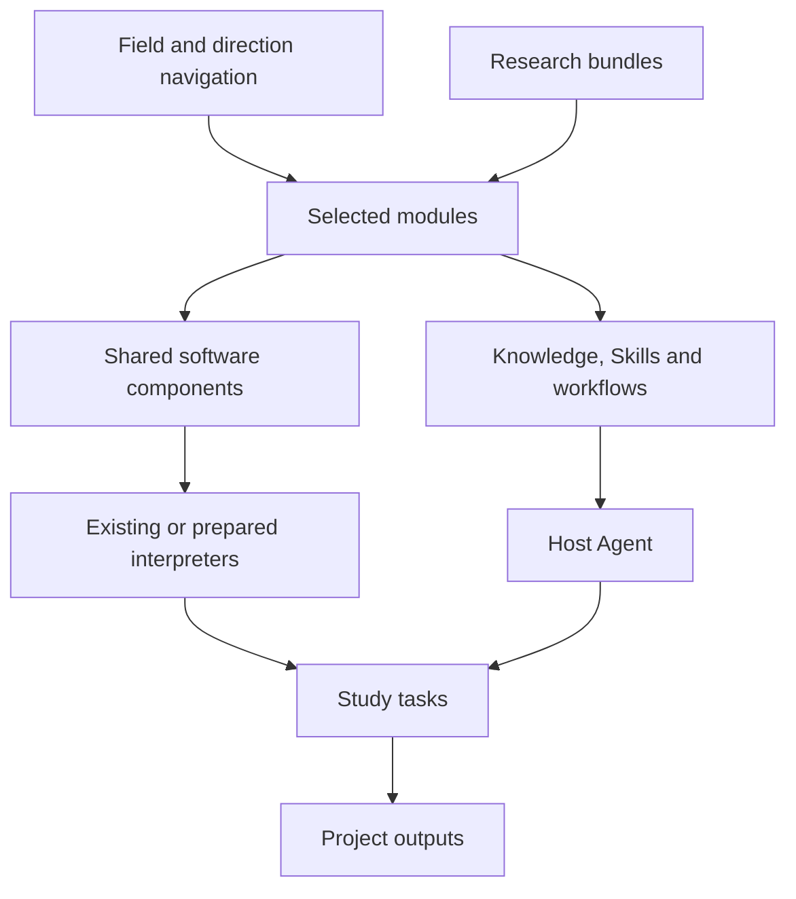

# Architecture

The navigation hierarchy and the dependency graph solve different problems. Fields and directions help a researcher find relevant work. Modules are reusable capabilities. Components are installable software groups or external connections. A module may occur under several directions and share components with many other modules.

`Catalog` loads one registry and expands explicit selections. `Manager` resolves software, materializes selected resources and maintains a small SQLite registry. Python, R and Node components use their own package managers. A runtime probe checks imports and requirement constraints before reuse. Desktop programs and service connections retain their own installation model.

Each Python component has an isolated environment when a compatible interpreter is unavailable. Later modules can reuse an already prepared environment if it contains their required packages. R packages share an HSS library; Node packages are installed within the selected component. Package caches are shared. The implementation does not predict exact download or disk usage before package resolution; `plan` reports known resource bytes and leaves unknown software sizes as null.

Installed assets are placed by role: knowledge, Skills, prompts, workflows, software and database indexes. The registry records ownership so removing one module preserves shared assets. Edited files and external interpreters are retained. `uninstall` (or `remove --prune`) removes an unused managed software directory; R's shared library remains available for reuse.

Study tasks are a directed acyclic graph with explicit dependencies and optional derived-data connections. The worker runs in the configured interpreter, writes tables and result records into a project output directory, and produces a readable results document. Material operations use standard Python; statistical operations load the numerical stack only when needed. Upstream R adapters, project Python/R/JavaScript scripts, SQL and native text operations participate in the same task graph using registered runtimes.

Python implements environment operations and study execution. SQLite stores local installation state, selected knowledge and project bibliographies. TypeScript provides the host client, module picker and research workbench. Rust and C++ supply selected native text engines; SQL files define the local databases. R scripts address methods whose established implementation belongs in R. No additional service is necessary to browse or prepare a local research environment.

The bundled workflow files guide research stages; they are not executable statistical DAGs. `study.json` describes actual computational tasks. A host Agent connects the two by developing the design with the researcher and writing the concrete tasks.
